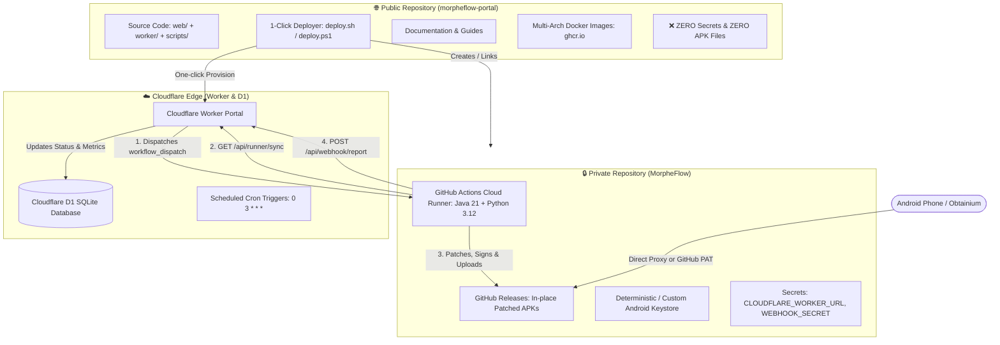
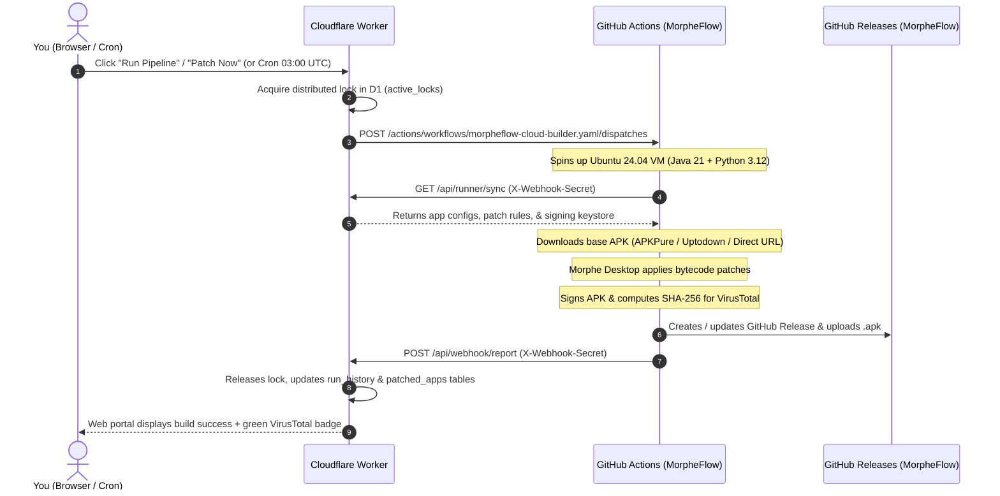

# MorpheFlow Repository Operations & Maintenance Guide

This document defines the operational architecture, synchronization procedures, and health-check verification steps for managing the MorpheFlow ecosystem across its two repositories:

* 🌐 **Public Repository (Open-Source Portal)**: [wiwek13/morpheflow-portal](https://github.com/wiwek13/morpheflow-portal) — Shared publicly with the community. Contains source code, Web UI, Cloudflare Worker backend, and deploy automation.
* 🔒 **Private Repository (Cloud Builder & Releases)**: [wiwek13/MorpheFlow](https://github.com/wiwek13/MorpheFlow) — Personal private repository. Executes cloud builds via GitHub Actions and hosts compiled APK releases and signing keys.

---

## 📑 Table of Contents

1. [Dual-Repository Architecture & Roles](#1-dual-repository-architecture--roles)
2. [Secrets & 2-Way Handshake Configuration](#2-secrets--2-way-handshake-configuration)
3. [Git Remote Configuration & Synchronization](#3-git-remote-configuration--synchronization)
4. [End-to-End Build & Distribution Pipeline](#4-end-to-end-build--distribution-pipeline)
5. [Android Updates via Obtainium (1-Click Sync)](#5-android-updates-via-obtainium-1-click-sync)
6. [Operational Verification Checklist ("Is It Working?")](#6-operational-verification-checklist-is-it-working)
7. [Troubleshooting & Common Pitfalls](#7-troubleshooting--common-pitfalls)

---

## 1. Dual-Repository Architecture & Roles



### Role Breakdown

| Component | Repository | Visibility | Contents & Responsibilities |
|---|---|---|---|
| **Public Portal & Codebase** | `wiwek13/morpheflow-portal` | **Public** | Clean MIT-licensed source code, Web UI, Cloudflare Worker code, Dockerfile, documentation, deployment scripts. **Never hosts APK binaries or private credentials.** Anyone can fork or star. |
| **Private Cloud Runner & Releases** | `wiwek13/MorpheFlow` | **Private** | Executes `.github/workflows/morpheflow-cloud-builder.yaml` on free GitHub Actions runners. Stores private APK releases (`app-<pkg>` and `build-<timestamp>`), signing keystore, and build logs. |
| **Cloudflare Edge Control Plane** | Cloudflare Workers (`morpheflow-db`) | **Private (Secured)** | Edge dashboard, D1 database storing app configurations, VirusTotal audit links, lock mutexes, and Obtainium manifests. |

---

## 2. Secrets & 2-Way Handshake Configuration

The Cloudflare Worker and the private GitHub Actions runner communicate securely using a cryptographic 2-way handshake:

```
[Cloudflare Worker]  ──(dispatches build with GITHUB_TOKEN)──►  [GitHub Actions Runner]
[Cloudflare Worker]  ◄──(reports results with WEBHOOK_SECRET)───  [GitHub Actions Runner]
```

### Side A: Cloudflare Worker Secrets
These secrets must be set in your Cloudflare Worker environment:

| Secret Name | Purpose | Example Value / Source |
|---|---|---|
| `AUTH_PASSWORD` | Master password for single-user web portal login. | Auto-generated or your custom password. |
| `WEBHOOK_SECRET` | HMAC secret to authenticate incoming build reports. | Random 32-character hex string. |
| `GITHUB_REPO` | Target private repository for cloud builds. | `wiwek13/MorpheFlow` |
| `GITHUB_TOKEN` | GitHub Personal Access Token (classic) with `repo` and `workflow` scopes. | `ghp_...` (from GitHub Settings > Developer Settings > Personal Access Tokens). |

To verify or update secrets on Cloudflare:
```bash
# List configured secrets (names only)
npx wrangler secret list

# Update any individual secret
npx wrangler secret put GITHUB_REPO
npx wrangler secret put GITHUB_TOKEN
npx wrangler secret put WEBHOOK_SECRET
npx wrangler secret put AUTH_PASSWORD
```

### Side B: GitHub Repository Secrets (`wiwek13/MorpheFlow`)
In your **private** repository (`wiwek13/MorpheFlow` ➔ **Settings** ➔ **Secrets and variables** ➔ **Actions**):

| Secret Name | Purpose | Example Value |
|---|---|---|
| `CLOUDFLARE_WORKER_URL` | The endpoint where GitHub Actions fetches config and sends telemetry. | `https://morpheflow.<your-subdomain>.workers.dev` |
| `WEBHOOK_SECRET` | Must match the `WEBHOOK_SECRET` configured on Cloudflare Worker. | Same string as Worker's `WEBHOOK_SECRET` |

Verify via CLI:
```bash
gh secret list -R wiwek13/MorpheFlow
```

> [!IMPORTANT]
> **Mandatory GitHub Actions Permission Setting:**  
> On `wiwek13/MorpheFlow`, go to:  
> **Settings ➔ Actions ➔ General ➔ Workflow permissions**  
> Select **"Read and write permissions"** and check **"Allow GitHub Actions to create and approve pull requests"**, then click **Save**.  
> *If this is not set to Read and write, cloud builds will fail with HTTP 403 when trying to publish APK releases.*

### Side C: Public Repository (`wiwek13/morpheflow-portal`)
* **NO personal secrets** should ever be stored here.
* The public repository only runs CI checks (Docker multi-arch builds and package creation on tags).

---

## 3. Git Remote Configuration & Synchronization

To maintain code in both repositories effortlessly from your local clone without accidental leaks:

### 3.1 Check Your Current Remotes
Run:
```bash
git remote -v
```
Your configured remotes should appear as:
```text
morpheflow-portal    git@github.com:wiwek13/morpheflow-portal.git (fetch)
morpheflow-portal    git@github.com:wiwek13/morpheflow-portal.git (push)
origin               git@github.com:wiwek13/MorpheFlow.git (fetch)
origin               git@github.com:wiwek13/MorpheFlow.git (push)
upstream             git@github.com:holjab/AutoMorph.git (fetch)
upstream             git@github.com:holjab/AutoMorph.git (push)
```

If any remote is missing, configure it with:
```bash
git remote add origin git@github.com:wiwek13/MorpheFlow.git
git remote add morpheflow-portal git@github.com:wiwek13/morpheflow-portal.git
git remote add upstream git@github.com:holjab/AutoMorph.git
```

### 3.2 Pushing Updates Safely

When you make improvements or fixes to the codebase:

```bash
# 1. Verify tests and TypeScript pass before pushing
npm run check

# 2. Commit your changes
git add .
git commit -m "feat: your new feature or fix"

# 3. Push to your PRIVATE repository (origin)
git push origin main

# 4. Push code to your PUBLIC repository (morpheflow-portal)
# NOTE: DO NOT push release tags to the public portal!
git push morpheflow-portal main
```

> [!WARNING]
> **Never run `git push morpheflow-portal --tags`**  
> Your local git repository contains release tags created by your private APK builds (e.g. `app-com.reddit.frontpage`, `build-*`). Pushing tags to the public repository would pollute the public release page with private build markers. Only push the `main` branch to `morpheflow-portal`.

### 3.3 Optional: Setup a Dual-Push Remote
To push the `main` branch to both repositories in a single command without touching tags:
```bash
git remote add all git@github.com:wiwek13/MorpheFlow.git
git remote set-url --add --push all git@github.com:wiwek13/MorpheFlow.git
git remote set-url --add --push all git@github.com:wiwek13/morpheflow-portal.git
```
Then you can simply run:
```bash
git push all main
```

### 3.4 Syncing from Upstream
If upstream updates are published:
```bash
git fetch upstream
git merge upstream/main
npm run check
git push origin main
git push morpheflow-portal main
```

---

## 4. End-to-End Build & Distribution Pipeline

### How a Build Executes



### Triggering Builds
You have three ways to trigger builds:
1. **From Web Portal**: Click **"Run Pipeline"** on the home dashboard (or click **"Patch Now"** on any app card).
2. **From GitHub CLI**:
   ```bash
   # Build all waiting apps
   gh workflow run morpheflow-cloud-builder.yaml -R wiwek13/MorpheFlow

   # Build a specific app
   gh workflow run morpheflow-cloud-builder.yaml -R wiwek13/MorpheFlow -f target_package="com.reddit.frontpage"
   ```
3. **Automated Cron**: Cloudflare Cron Trigger runs automatically every day at `03:00 UTC`.

---

## 5. Android Updates via Obtainium (1-Click Sync)

[Obtainium](https://github.com/ImranR98/Obtainium) installs and automatically updates your patched apps directly on your phone.

### Method 1: Web Portal 1-Click Sync (Zero-Token Setup)
Because your Cloudflare Worker serves authenticated proxy downloads:
1. Open your MorpheFlow portal in Chrome/Firefox on your Android phone.
2. In the navigation bar, tap **"Obtainium Sync"**.
3. Select your apps from the checklist and tap **"Import Selected to Obtainium"**.
4. Obtainium opens and registers the apps automatically.

### Method 2: Direct GitHub Releases Tracking (Private Repo)
If tracking directly through GitHub Releases in Obtainium:
1. Open Obtainium ➔ **Settings** ➔ **GitHub Token**.
2. Paste your GitHub Personal Access Token (`ghp_...` with `repo` read access).
3. Tap **Add App** in Obtainium and enter: `https://github.com/wiwek13/MorpheFlow`.
4. Obtainium will seamlessly track all private releases and update apps in the background.

---

## 6. Operational Verification Checklist ("Is It Working?")

Run this quick 5-minute health check whenever you make changes to verify that the entire chain is functional:

### Step 1: Local Integrity Test
Run the test suite and TypeScript compiler:
```bash
npm run check
```
- [ ] TypeScript emits zero errors (`tsc --noEmit`).
- [ ] All 78 unit & integration tests pass with 0 failures.

### Step 2: Verify Cloudflare Worker Live Status
Visit your deployed Worker URL:
```bash
curl -s -o /dev/null -w "%{http_code}\n" https://morpheflow.<your-subdomain>.workers.dev/
```
- [ ] Returns HTTP `200` (or prompts for login).
- [ ] Web dashboard opens with system metrics, active app cards, and status badges.

### Step 3: Verify GitHub Actions Permissions on Private Repo
```bash
gh api repos/wiwek13/MorpheFlow/actions/permissions/workflow -q .default_workflow_permissions
```
- [ ] Output is `write`.

### Step 4: Verify Secrets on Both Sides
```bash
# Verify GitHub Actions secrets
gh secret list -R wiwek13/MorpheFlow
```
- [ ] Contains `CLOUDFLARE_WORKER_URL`.
- [ ] Contains `WEBHOOK_SECRET`.

```bash
# Verify Cloudflare Worker secrets
npx wrangler secret list
```
- [ ] Contains `AUTH_PASSWORD`.
- [ ] Contains `GITHUB_REPO` (value is `wiwek13/MorpheFlow`).
- [ ] Contains `GITHUB_TOKEN`.
- [ ] Contains `WEBHOOK_SECRET` (matches GitHub's secret).

### Step 5: Test Cloud Build Dispatch
Dispatch a test build for a lightweight application:
```bash
gh workflow run morpheflow-cloud-builder.yaml -R wiwek13/MorpheFlow -f target_package="com.pittvandewitt.wavelet"
```
Monitor the run:
```bash
gh run list -R wiwek13/MorpheFlow --limit 1
gh run watch -R wiwek13/MorpheFlow
```
- [ ] Workflow completes with a green checkmark (`completed` / `success`).
- [ ] Release is updated on [wiwek13/MorpheFlow/releases](https://github.com/wiwek13/MorpheFlow/releases).
- [ ] Web portal updates the app card with the installed version, duration, and VirusTotal report link.

### Step 6: Verify Public Repository Hygiene
```bash
gh release list -R wiwek13/morpheflow-portal
gh secret list -R wiwek13/morpheflow-portal
```
- [ ] Releases: `no releases found` (clean).
- [ ] Secrets: `no secrets found` (clean).

---

## 7. Troubleshooting & Common Pitfalls

### Issue 1: GitHub Actions fails with "Resource not accessible by integration" (HTTP 403)
* **Root Cause**: GitHub Actions does not have permission to create Releases or upload binaries.
* **Resolution**: Go to `wiwek13/MorpheFlow` ➔ **Settings** ➔ **Actions** ➔ **General** ➔ **Workflow permissions** ➔ select **"Read and write permissions"** ➔ click **Save**.

### Issue 2: Clicking "Run Pipeline" returns 500: "GITHUB_TOKEN is not configured"
* **Root Cause**: The Cloudflare Worker is missing the GitHub Personal Access Token.
* **Resolution**:
  ```bash
  npx wrangler secret put GITHUB_TOKEN
  # Paste your classic GitHub token with repo + workflow scopes
  ```

### Issue 3: GitHub Actions completes but Web Portal doesn't update (HTTP 401 on callback)
* **Root Cause**: `WEBHOOK_SECRET` on Cloudflare Worker does not match `WEBHOOK_SECRET` on GitHub.
* **Resolution**: Generate a new secret and synchronize both:
  ```bash
  NEW_SECRET=$(node -e "console.log(require('crypto').randomBytes(16).toString('hex'))")
  echo "$NEW_SECRET" | npx wrangler secret put WEBHOOK_SECRET
  gh secret set WEBHOOK_SECRET --body "$NEW_SECRET" -R wiwek13/MorpheFlow
  ```

### Issue 4: Android App Update fails with "App not installed as package appears to be invalid"
* **Root Cause**: Keystore signature mismatch (the previously installed APK was signed with a different key than the newly built APK).
* **Resolution**:
  1. If updating an app originally installed via official ReVanced / Morphe, export your existing keystore from the app.
  2. Open MorpheFlow Web Portal ➔ **Settings** ➔ **Keystore Management** ➔ **Import Keystore**.
  3. Rebuild the app so it is signed with your personal keystore.

### Issue 5: Need to redeploy Worker after modifying code
* **Command**:
  ```bash
  ./deploy.sh
  # or
  npm run deploy
  ```

---

## Summary Checklist for Day-to-Day Maintenance

| Action | Command | Target |
|---|---|---|
| Run tests & typecheck | `npm run check` | Local |
| Deploy Worker & UI | `./deploy.sh` | Cloudflare Workers |
| Push code updates | `git push origin main && git push morpheflow-portal main` | Both Repositories |
| Trigger manual cloud build | `gh workflow run morpheflow-cloud-builder.yaml -R wiwek13/MorpheFlow` | Private Builder |
| View build logs & history | `gh run list -R wiwek13/MorpheFlow` | Private Builder |
| Bump release version | `npm run bump:patch` (or `minor`/`major`) | Local & Worker |
