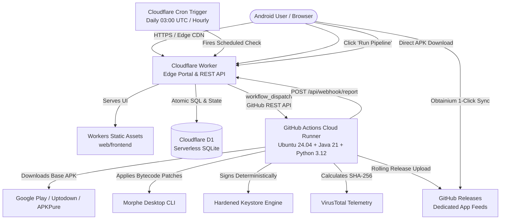

<div align="center">
  
  <h1>MorpheFlow</h1>
  <p><strong>A Cloud-Native Edge Control Plane, Pure Patch Studio & Automated Build Pipeline for Android Packages</strong></p>

  <p>
    <a href="https://github.com/wiwek13/morpheflow-portal/releases"></a>
    <a href="https://workers.cloudflare.com"></a>
    <a href="https://github.com/ImranR98/Obtainium"></a>
    <a href="https://www.virustotal.com"></a>
    <a href="#-legal-disclaimer--educational-use"></a>
    <a href="LICENSE"></a>
  </p>
</div>

> [!IMPORTANT]
> **Educational & Research Purposes Only**  
> MorpheFlow is an open-source automation utility and edge management console developed strictly for **educational, security research, interoperability, and personal backup purposes**. MorpheFlow does **not** host, pirate, distribute, or link to any copyrighted APK binaries or proprietary intellectual property. All bytecode patching operations are executed in the user's own isolated environment using publicly available patch definitions. Users are solely responsible for ensuring compliance with all applicable local laws, intellectual property rights, and third-party Terms of Service.

---

## 👶 Explain Like I'm 5 (ELI5): What is MorpheFlow?

### 🛑 The Problem
You want to use your favorite Android apps without annoying ads and with premium features (like **YouTube ReVanced**, **Reddit** without promoted spam, or **Instagram** with clean AMOLED dark mode).

Normally, doing this is a huge hassle:
- You have to download sketchy pre-patched `.apk` files from random websites that might contain malware or spyware.
- Or you have to manually run complex patcher programs on your PC and plug your phone in with cables every single time an app releases an update.

### 💡 The MorpheFlow Solution
**MorpheFlow gives you a personal, automated robot in the cloud:**
1. **You control it from a clean website**: Access your own private web dashboard from any browser or phone. Drag-and-drop any `.apk` file, paste a direct download link, or choose from 1,354+ popular apps in the built-in catalog.
2. **It compiles everything in the cloud for free**: Free GitHub servers download the clean original app, apply your chosen patches, and sign it securely. You don't need to keep your PC turned on or pay for a VPS server.
3. **It verifies safety with VirusTotal**: Every compiled APK is automatically scanned and audited with SHA-256 digests so you know it is 100% clean and safe before installing.
4. **Your phone updates automatically**: Connect your dashboard to [Obtainium](https://github.com/ImranR98/Obtainium) on your Android phone with **1 click**. Whenever YouTube or Reddit releases a new version, your cloud robot compiles it, and your phone updates it silently in the background!
5. **Cost? 100% Free Forever**: Runs entirely on Cloudflare's and GitHub's free tiers. No credit card required.

---

## 📋 What You Need First (Prerequisites)

Everything used by MorpheFlow is **100% free** and requires **zero credit card**:

| Prerequisite | Why You Need It | How to Get It |
|---|---|---|
| **Free GitHub Account** | Runs your cloud builds (GitHub Actions) and stores your private APK releases. | [Sign up on GitHub](https://github.com/join) |
| **GitHub CLI (`gh`)** | Allows the automated setup script to create your private repository and link secrets. | Mac: `brew install gh`<br>Windows: `winget install GitHub.cli`<br>Linux: `sudo apt install gh` (or [cli.github.com](https://cli.github.com/)) |
| **Free Cloudflare Account** | Hosts your personal web portal on the edge so you can manage your apps from anywhere. | [Sign up on Cloudflare](https://dash.cloudflare.com/sign-up) |
| **Cloudflare Wrangler CLI** | Deploys your web dashboard to Cloudflare with one simple command. | Runs on-demand via `npx wrangler` (included with Node.js) |
| **Node.js (v18+) & npm** | Runs the automated 1-click deployment script. | Download from [nodejs.org](https://nodejs.org/) (or `brew install node`) |
| **Android Phone with Obtainium** | Installs your patched apps and keeps them updated in the background. | Download [Obtainium on GitHub](https://github.com/ImranR98/Obtainium/releases) |

---

## 🚀 ELI5: Complete Setup in 4 Easy Steps

### Step 1: Log in to your free accounts in your terminal (1 minute, one-time)
Open your terminal (Terminal on Mac/Linux, or PowerShell on Windows) and log into your accounts:

```bash
# 1. Log in to GitHub (choose "GitHub.com" > "HTTPS" > "Login with a web browser")
gh auth login

# 2. Log in to Cloudflare (a browser window will pop up to authorize)
npx wrangler login
```

---

### Step 2: Download & run the 1-Click Setup Script (~90 seconds)
Run these commands in your terminal:

```bash
# 1. Clone the repository
git clone https://github.com/wiwek13/morpheflow-portal.git
cd morpheflow-portal

# 2. Run the automated installer
./deploy.sh          # macOS / Linux
.\deploy.ps1         # Windows PowerShell
```

**What the script does automatically for you behind the scenes:**
- 🔒 **Creates a private GitHub repository** (`<your-username>/MorpheFlow`) on your personal GitHub account so your builds, APK releases, and signing keys stay 100% private to you.
- 🗄️ **Creates your free Cloudflare D1 database** to save your app selections, options, and logs.
- 🌐 **Deploys your edge web dashboard** to `https://morpheflow.<your-subdomain>.workers.dev`.
- 🔑 **Links GitHub Actions and Cloudflare** with encrypted secrets and write permissions so they talk to each other automatically.
- 📋 **Prints your live website link and master password** right in the terminal!

---

### Step 3: Open your web dashboard & patch your first app
1. Click the website link printed in your terminal (e.g. `https://morpheflow.<your-subdomain>.workers.dev`).
2. Log in using the master password generated in Step 2.
3. Choose how to patch:
   - **Option A (Instant Upload & Patch)**: Click the **"Upload & Patch"** button on the Home screen. Drop any `.apk` file or paste a direct download URL.
   - **Option B (Community Catalog)**: Click **"Provision New App"**, select from 1,354+ community apps (YouTube, Reddit, Instagram, etc.), and choose your preferred patches (Ad Blocking, AMOLED Black, SponsorBlock, etc.).
4. Click **"Run Pipeline"** — your private GitHub cloud builder will patch, sign, VirusTotal-scan, and upload your release in ~2-3 minutes.

---

### Step 4: Connect your Android phone for background auto-updates
1. Open your personal MorpheFlow dashboard on your Android phone's browser.
2. Tap the **"1-Click Sync to Obtainium"** button.
3. Obtainium opens and imports all your selected apps automatically.
4. **Done!** Obtainium installs your apps now, and automatically updates them in the background whenever new versions or patches are released.

---

## 🌟 Technical Overview

---

## 📸 Screenshots

<div align="center">
  <h3>Operations Queue & Live Telemetry</h3>
  <p><em>Modern glassmorphic dashboard featuring real-time build telemetry, SemVer target tracking, and live VirusTotal security verdicts.</em></p>
  
</div>

<br>

<div align="center">
  <table width="100%">
    <tr>
      <td width="50%" align="center">
        <h4>Obtainium 1-Click Sync & Feeds</h4>
        
        <p><em>Bulk deep-link import & dedicated per-app release feeds for background auto-updates.</em></p>
      </td>
      <td width="50%" align="center">
        <h4>Pure Patch Studio & App Provisioning</h4>
        
        <p><em>Multi-bundle exploration, conflict linting, and universal vs app-matched patch separation.</em></p>
      </td>
    </tr>
    <tr>
      <td width="50%" align="center">
        <h4>Settings, Storage & Keystore Hub</h4>
        
        <p><em>Cloudflare D1 management, deterministic keystores, and tunnel endpoints.</em></p>
      </td>
      <td width="50%" align="center">
        <h4>Mobile Responsive Monolith</h4>
        
        <p><em>Horizontally scrollable navigation dock, phone autosizing, and native bottom sheets.</em></p>
      </td>
    </tr>
  </table>
</div>

---

## ⚡ Key Features

- **⚡ Direct Home "Upload & Patch" (File Upload or Direct Download URL)**:
  - Drag-and-drop any clean base `.apk` binary or paste a direct HTTP/HTTPS download link straight from the Home Operations Queue.
  - Automatically matches against the 1,354-app Community Catalog, auto-provisions the application, streams upload chunks with real-time progress bars or direct cloud linking, and immediately initiates the compilation build pipeline with a single click.
- **🌐 Serverless Cloudflare Edge Architecture (100% Free)**:
  - Runs natively on Cloudflare Workers with **Cloudflare D1** (serverless distributed SQLite) and **Workers Static Assets**.
  - Isolate memoization and `db.batch()` execution ensures sub-millisecond edge response times with zero cold start overhead.
  - Zero VPS required, zero maintenance, zero hosting bills.
- **📱 Obtainium 1-Click Sync & Deep Links**:
  - Direct integration with [Obtainium](https://github.com/ImranR98/Obtainium) via `obtainium://apps/` bulk deep links.
  - Generates dedicated per-app release tags (`app-<package_name>`) and zero-token public edge manifest feeds (`/api/obtainium/manifest.json`), enabling seamless background auto-updates on Android.
- **🛡️ Automated VirusTotal Security Telemetry**:
  - Automatically calculates SHA-256 binary digests for every compiled APK and surfaces prominent `0/72 Clean` security shields directly on app cards.
  - One-click permalinks launch the full VirusTotal file report in a new tab.
- **🔑 Deterministic & Custom Keystore Engine**:
  - Ships with a pre-configured, hardened deterministic keystore to ensure consistent signature fingerprints across builds, preventing Android "App not installed: signature mismatch" errors.
  - Full UI export and import support for custom keystores with automated GitHub Actions Cloud Runner synchronization.
- **🧩 Pure Patch Studio & Conflict Resolution**:
  - Multi-source aggregation across Morphe, ReVanced, and community patch repositories.
  - Clean separation between active patches, app-specific features, and universal mutators.
  - Bytecode conflict detection flags mutually incompatible patches before compiling.
- **🔄 SemVer 2.0 Pre-release Precedence**:
  - Handles 2, 3, 4, and 5-segment Android version numbers.
  - Adheres strictly to SemVer 2.0.0 pre-release precedence so stable releases always take precedence over beta/alpha releases.
- **📥 Robust APK Ingestion Cascade**:
  - Automatic download cascade prioritising Google Play Store ([`goopdl`](https://github.com/Villoh/goopdl)), with automatic fallbacks to Uptodown, APKCombo, and APKPure.
  - Manual base APK upload with real-time percentage and megabyte upload progress bars.
- **🚀 Parallel Concurrency & Process Safety**:
  - Concurrent batch dispatch using `Promise.allSettled` with instant lock release for failed packages.
  - Atomic OS file locks (`O_CREAT | O_EXCL`) and D1 relational `active_locks` table to prevent race conditions.
  - Subprocess cancellation cleans child process groups via `SIGINT` escalating to `SIGKILL` before lock release.
- **🔒 Single-User Airtight Security**:
  - Timing-safe HMAC session authentication, automated brute-force rate-limiting with auto-pruning, and strict Content Security Policies.

---

## 🏗️ Architecture & Mental Model



---

## 🚀 Quick Start & Deployment

MorpheFlow ships two runtimes: **Cloudflare Workers (serverless edge)** and the **self-hosted backend** (FastAPI on `:8080`).
Pick the self-hosted install format that fits your machine:

| Format | Best for | Command |
|---|---|---|
| Docker Compose | Homelab (Unraid/Proxmox/TrueNAS), Oracle VPS | `docker compose -f default_compose.yaml up -d` |
| 1-line installer | Fastest bare-metal / VPS setup | `curl -fsSL https://raw.githubusercontent.com/wiwek13/morpheflow-portal/main/install.sh \| bash` |
| `.deb` / `.rpm` | Debian/Ubuntu, Fedora/RHEL with `systemd` | download from [Releases](https://github.com/wiwek13/morpheflow-portal/releases), `sudo apt install ./morpheflow_*_amd64.deb` |
| AUR (`morpheflow-git`) | Arch Linux / CachyOS / EndeavourOS | `yay -S morpheflow-git` ([AUR page](https://aur.archlinux.org/packages/morpheflow-git)) |
| AppImage | Portable run without install (x86_64) | download `MorpheFlow-*-x86_64.AppImage`, `chmod +x` and run |

> Note: native packages (`.deb`/`.rpm`/AppImage/1-liner) install the **self-hosted backend**.
> The Cloudflare Workers edge portal is deployed separately via `./deploy.sh` below.

### Method 1: Cloudflare Workers (Recommended · 100% Free · Zero VPS)

Deploy the entire serverless portal and configure the cloud runner in under 2 minutes:

#### 1. Prerequisites
- **Node.js** (v18+) & **npm**
- **Cloudflare Wrangler CLI**: Run `npx wrangler login` to authorize your Cloudflare account.
- **GitHub CLI (`gh`)**: Run `gh auth login` to authorize private repo linking and GitHub Actions automation.

#### 2. Run the 1-Click Deployer
```bash
# Clone the repository
git clone https://github.com/wiwek13/morpheflow-portal.git
cd morpheflow-portal

# Run the automated deployer
./deploy.sh          # macOS / Linux
.\deploy.ps1         # Windows PowerShell
```
*(Or execute `npm run deploy`)*

The script automatically:
1. Verifies Cloudflare and GitHub CLI credentials.
2. Creates or connects your Cloudflare D1 database (`morpheflow-db`) and pins the UUID into `wrangler.toml`.
3. Applies database schema migrations atomically.
4. Generates a secure, random single-user master password.
5. Deploys the edge worker and static assets to `https://morpheflow.<subdomain>.workers.dev`.
6. Sets up your private GitHub Actions cloud builder and synchronizes secrets (`CLOUDFLARE_WORKER_URL`, `WEBHOOK_SECRET`, `GITHUB_TOKEN`).

---

### Method 2: Docker Compose (Self-Hosted Server / Homelab)

If you prefer self-hosting on your own homelab (Unraid, Proxmox, TrueNAS) or an Oracle Cloud Always Free VPS:

1. **Clone & Setup Environment**:
   ```bash
   git clone https://github.com/wiwek13/morpheflow-portal.git
   cd morpheflow-portal
   cp example.env .env
   ```
2. **Configure Remote Access & Tunnels**:
   Edit `.env` to configure your preferred tunnel ([Pangolin, Tailscale Funnel, or Cloudflare](docs/tunnels.md)) and email notification settings.
3. **Start the Container**:
   ```bash
   docker compose pull
   docker compose up -d
   ```
4. Access your portal at `http://localhost:8080` (or via your configured tunnel).

### Method 3: Native packages — `.deb`, `.rpm`, AppImage, 1-line installer

Native packages install the same self-hosted backend as Docker, but as a `systemd` service
(`morpheflow.service` → `http://127.0.0.1:8080`) instead of a container. Requires Python 3.11+
and Java 21 (declared as package dependencies and checked at install time).

**Option A — 1-line installer** (installs Docker Compose setup by default):

```bash
curl -fsSL https://raw.githubusercontent.com/wiwek13/morpheflow-portal/main/install.sh | bash
# variants:
curl -fsSL https://raw.githubusercontent.com/wiwek13/morpheflow-portal/main/install.sh | bash -s -- --native    # .deb/.rpm + systemd service
curl -fsSL https://raw.githubusercontent.com/wiwek13/morpheflow-portal/main/install.sh | bash -s -- --appimage   # portable AppImage
```

**Option B — `.deb` (Debian/Ubuntu)**:

```bash
# From the Releases page (tagged builds attach .deb/.rpm/AppImage automatically):
sudo apt install ./morpheflow_2.4.1-1_amd64.deb
sudo systemctl enable --now morpheflow
# Dashboard: http://127.0.0.1:8080
```

**Option C — `.rpm` (Fedora/RHEL)**:

```bash
sudo dnf install ./morpheflow-2.4.1-1.x86_64.rpm
sudo systemctl enable --now morpheflow
```

**Option D — AppImage (portable, x86_64)**:

```bash
chmod +x MorpheFlow-2.4.1-x86_64.AppImage
./MorpheFlow-2.4.1-x86_64.AppImage   # needs system python3 (>=3.11) + Java 21
```

**Option E — Arch Linux (AUR, [`morpheflow-git`](https://aur.archlinux.org/packages/morpheflow-git))**:

```bash
yay -S morpheflow-git          # or: paru -S morpheflow-git
sudo systemctl enable --now morpheflow
```

No AUR helper? Build directly from this repo (same sources as the AUR package):

```bash
cd packaging/aur
makepkg -si   # needs base-devel + git; never run makepkg as root
```

The AUR packaging (`packaging/aur/PKGBUILD` + `.SRCINFO` + `morpheflow.install`)
mirrors the `.deb`/`.rpm` layout: code in `/opt/morpheflow`, venv + `morphe.jar`
created once by the install scriptlet, state in `/var/lib/morpheflow`.
It is published as a `-git` package tracking `main` because upstream
publishes no version tags yet; `.SRCINFO` is regenerated with
`makepkg --printsrcinfo` before each AUR push.

**Build packages locally**:

```bash
./packaging/build.sh --version 2.4.1 --arch amd64   # .deb + .rpm into dist/
./packaging/appimage/build-appimage.sh --version 2.4.1
```

Service layout: code in `/opt/morpheflow`, state in `/var/lib/morpheflow`,
logs via `journalctl -u morpheflow`. Python venv is created at `/opt/morpheflow/.venv`
and the Morphe patcher jar is fetched once by the post-install script
(`packaging/postinst.sh`). Uninstalling the package keeps `/var/lib/morpheflow` data.

---

## 📱 Android Auto-Updates with Obtainium

MorpheFlow provides native first-class support for [Obtainium](https://github.com/ImranR98/Obtainium):

1. Open your MorpheFlow portal on your Android device (or desktop).
2. Click **Obtainium Sync** in the top navigation bar.
3. Tap **Add All to Obtainium** to bulk import all your active packages in one click via `obtainium://apps/` deep links.
4. *Private Repository Support*: If your GitHub build repository is private, create a GitHub Personal Access Token (PAT) with `read-only` contents permission and add it once in **Obtainium Settings > GitHub**.
5. Obtainium will now automatically poll, download, and update all your patched apps silently in the background!

---

## 📚 Documentation Hub

Explore comprehensive guides in our **[Documentation Hub](docs/README.md)**:

* ⚡ **[Cloudflare Workers Setup Guide](docs/cloudflare-workers-setup.md)**: Deep dive into D1 database schemas, edge routing, and GitHub Actions cloud runners.
* 📖 **[User Guide & Web Interface](docs/user-guide.md)**: Managing packages, Pure Patch Studio, custom patch options, and daily scheduling.
* 🚇 **[Remote Access & Tunnels Guide](docs/tunnels.md)**: Setting up Pangolin, Tailscale Funnel, or Cloudflare Tunnels for self-hosted instances.
* ☁️ **[Oracle Free Tier VPS Guide (Optional)](docs/oracle-setup.md)**: How to launch an Always Free VPS on Oracle Cloud Infrastructure.

---

## 🧪 Testing & Verification

MorpheFlow features a comprehensive test suite covering SemVer resolution, atomic locking, VirusTotal integration, Obtainium filtering, and mobile viewport responsiveness:

```bash
# Run unit and integration tests
npm test

# Run TypeScript static type verification
npm run types:check
```

---

## ❤️ Credits & Acknowledgements

MorpheFlow stands on the shoulders of incredible open-source projects and communities:

* **[AutoMorph](https://github.com/holjab/AutoMorph) & [holjab](https://github.com/holjab)**: Heartfelt gratitude to holjab and the AutoMorph community. AutoMorph created the foundational concept, Python scheduling orchestration, and base APK scraping logic that inspired MorpheFlow.
* **[Morphe Desktop](https://morphe.software)**: The cutting-edge Android patching engine that powers MorpheFlow's APK bytecode modification.
* **[ReVanced Team & Community](https://revanced.app)**: The pioneers of modern Android reverse engineering, patcher architecture, and modular patch bundles.
* **[Obtainium](https://github.com/ImranR98/Obtainium) by ImranR98**: The unmatched open-source Android package manager that makes seamless app auto-updates possible.
* **[goopdl](https://github.com/Villoh/goopdl) by Villoh**: Fast, automated package downloads directly from the Google Play Store.
* **[Inotia00 & ReVanced Extended](https://github.com/inotia00)**: For extended patch sets, microg compatibility components, and community support.
* **Team Vanced**: In memory of the pioneers who originally demonstrated the potential of client-side Android enhancement.

---

## ⚖️ Legal Disclaimer & Educational Use

### 1. Educational & Interoperability Research
MorpheFlow is designed, developed, and distributed solely for **educational, computer science research, and software interoperability evaluation**. Its primary purpose is to demonstrate serverless edge computing on Cloudflare Workers, distributed relational state management via Cloudflare D1, and modular Android bytecode analysis.

### 2. No Distribution of Copyrighted Material
* This repository and the MorpheFlow edge console do **not** contain, distribute, host, mirror, or repackage any copyrighted, proprietary Android applications (`.apk` or `.dex` files).
* MorpheFlow does **not** host any central repository of pre-patched or cracked applications.
* Any downloading of original base packages is performed solely on the client machine or via the user's private runner from publicly accessible distribution endpoints as instructed by the user.

### 3. Private Runner Recommendation
> [!CAUTION]
> **Always Keep Cloud Builder Repositories Private**:  
> When using the GitHub Actions Cloud Runner deployment, your target build repository **must be configured as a PRIVATE repository**. Publishing releases containing copyrighted APK binaries to a public repository may violate third-party intellectual property rights and GitHub's Terms of Service. MorpheFlow's automated deployer (`deploy.sh` / `deploy-cf.cjs`) configures private repositories by default.

### 4. Trademark Attribution
All product names, trademarks, registered trademarks, and logos mentioned in this project (including but not limited to Android, Google, Google Play, YouTube, Reddit, Proton, and others) belong to their respective copyright holders. Reference to these trademarks is strictly for identification and interoperability compatibility purposes, and does not imply any affiliation, endorsement, or sponsorship.

### 5. Limitation of Liability
The authors and contributors of MorpheFlow assume no liability or responsibility for any misuse of this software, data loss, account suspension, or violation of third-party Terms of Service resulting from the use of this software. The end user accepts full legal responsibility for any actions taken using MorpheFlow.

---

## 📄 License

This project is licensed under the **MIT License** — see the [LICENSE](LICENSE) file for details.
All patched applications and third-party trademarks belong to their respective copyright holders.
