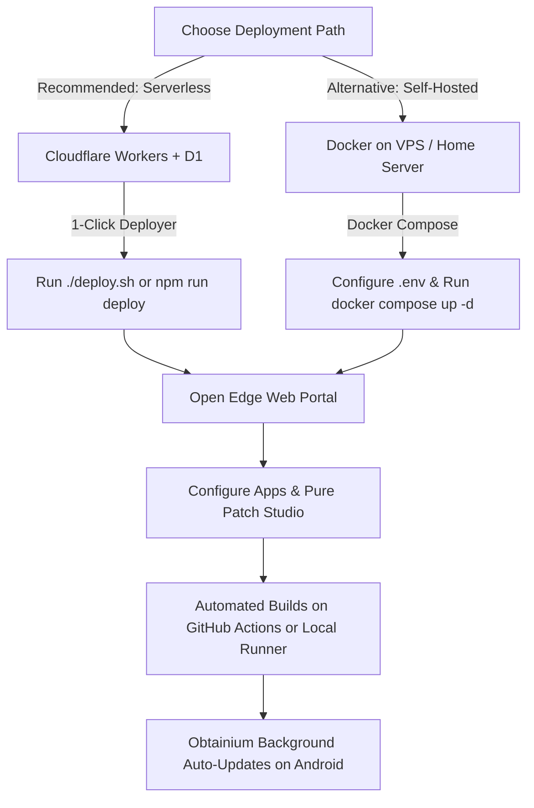

# MorpheFlow Documentation Hub

Welcome to the **MorpheFlow** documentation hub! MorpheFlow is a modern, cloud-native edge control plane and automated build pipeline for patching, deterministically signing, and distributing Android packages.

Whether deploying serverless on Cloudflare Workers edge (100% free) or self-hosting on your own hardware / cloud VPS via Docker, you'll find comprehensive setup and operational guides below.

> [!NOTE]
> **Educational & Research Notice**: MorpheFlow is strictly intended for educational, computer science research, and personal interoperability purposes. The project does not distribute or host proprietary APK binaries.

---

## 📚 Guides & Documentation

Choose a guide below to get started:

### ⚡ [1. Cloudflare Workers 100% Free Tier Setup (Serverless · Recommended)](cloudflare-workers-setup.md)
* *Zero VPS, Zero Credit Card Required*: Deploy MorpheFlow directly on Cloudflare Workers edge.
* High-performance static web portal hosted on Cloudflare Workers Static Assets.
* Serverless SQLite database (Cloudflare D1) with isolate memoization & atomic schema batching.
* Automated cloud patch runner on GitHub Actions with automated metric sync, dedicated Obtainium feeds, and rolling in-place APK releases.

### 📖 [2. User Guide & Web Interface](user-guide.md)
* Comprehensive tour of the MorpheFlow console:
  * Operations Queue, SemVer target analysis, and live VirusTotal security badges.
  * Adding packages via the Provision App Wizard.
  * **Pure Patch Studio**: Exploring community bundles, separating universal vs. app-matched mutators, and bytecode conflict linting.
  * Triggering single builds or batch parallel dispatches.
  * **Deterministic Keystores**: Protecting update signatures and importing custom keystores.
  * **Obtainium 1-Click Sync**: Setting up background APK auto-updates on Android devices.

### 🚇 [3. Remote Access & Tunnels Guide](tunnels.md)
* If using the self-hosted Docker runner, set up a secure tunnel to expose your portal:
  * **🔴 Pangolin**: Quickest setup, free public URL (or custom domain), zero domain cost required.
  * **🔵 Tailscale Funnel**: Zero-cost public HTTPS endpoint or private mesh access.
  * **🟠 Cloudflare Tunnels**: Best choice if you own a custom domain.

### ☁️ [4. Oracle Cloud Free Tier Setup (Optional)](oracle-setup.md)
* *Optional guide for self-hosters without hardware*: Learn how to launch an **Always Free** VPS on Oracle Cloud Infrastructure (OCI).
* Step-by-step walkthrough covering instance creation (`VM.Standard.E2.1.Micro`), cloud-init provisioning, and running Docker Compose.

---

## 🗺️ Recommended Architecture & Flow

---

## ⚙️ Key Project Architecture

* [`wrangler.toml`](../wrangler.toml): Cloudflare Workers configuration binding D1 database (`morpheflow-db`), cron triggers (`0 * * * *`, `0 3 * * *`), and Workers Static Assets (`web/frontend`).
* [`scripts/deploy-cf.cjs`](../scripts/deploy-cf.cjs): Zero-touch automated deployment script for Cloudflare Workers, D1 database creation, migration execution, secret synchronization, and GitHub runner linking.
* [`.github/workflows/morpheflow-cloud-builder.yaml`](../.github/workflows/morpheflow-cloud-builder.yaml): Cloud builder workflow with rolling in-place releases (`gh release edit` & `--clobber`), SHA-256 calculation, and webhook callbacks.
* [`default_compose.yaml`](../default_compose.yaml): Baseline Docker Compose specification with built-in profiles for Cloudflare and Pangolin tunnels.

---

## ❤️ Credits & Attribution

MorpheFlow is built with gratitude upon the pioneering work of:
* **[AutoMorph](https://github.com/holjab/AutoMorph) & [holjab](https://github.com/holjab)** for the foundational inspiration, scraping logic, and Python orchestration.
* **[Morphe Desktop](https://morphe.software)** for the high-performance Android bytecode patching engine.
* **[ReVanced Team](https://revanced.app)** for creating the modern Android reverse-engineering and patch ecosystem.
* **[Obtainium](https://github.com/ImranR98/Obtainium)** for the open-source update manager on Android.
* **[Villoh (goopdl)](https://github.com/Villoh/goopdl)** for Google Play Store downloading tools.

---

[← Back to Main Repository](../README.md)
