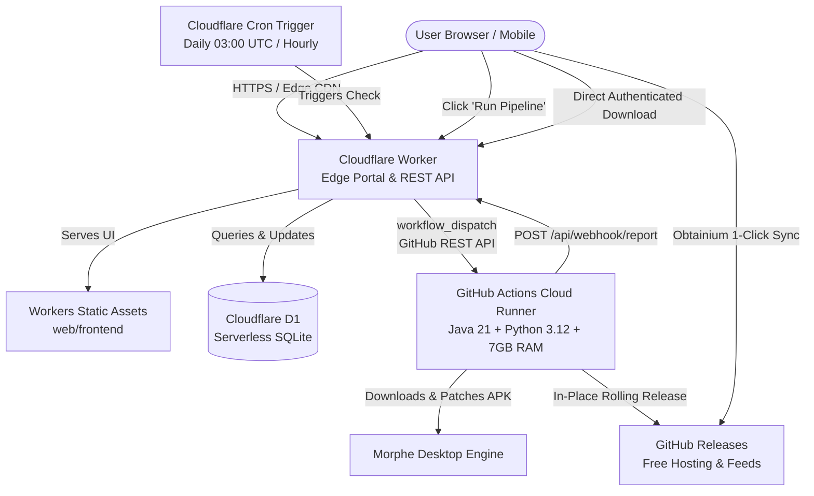
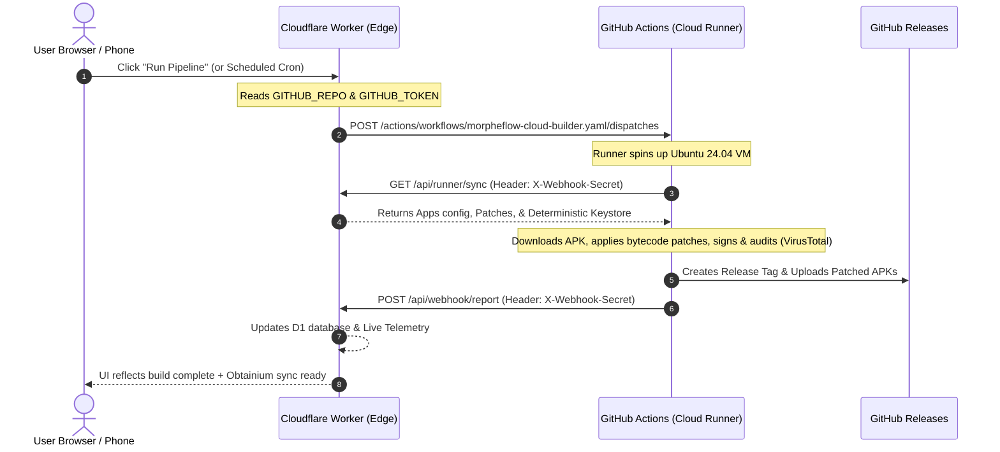

[🏠 Documentation Hub](README.md) › **Cloudflare Workers Free Tier Setup Guide**

---

# ☁️ Cloudflare Workers Deployment Guide (100% Free Tier)

Deploy MorpheFlow as a **serverless edge management portal and build distribution hub** directly on **Cloudflare Workers**.

This deployment method runs **100% within the Cloudflare Free Plan** and requires **zero credit card**:
* 🌐 **Global Edge Control Center**: Hosts the MorpheFlow Web Portal and REST management API across Cloudflare's 330+ edge locations with ultra-low latency and built-in DDoS mitigation.
* 💾 **Serverless SQLite (Cloudflare D1)**: Stores package configs, patch aliases, options, execution logs, and metrics (5 million reads/day and 100,000 writes/day free).
* 🔒 **Atomic Distributed Locking**: Relational `active_locks` table with SQL transactions prevents overlapping or duplicate build dispatches.
* ⏰ **Automated Daily Scheduling**: Cloudflare Workers Cron Triggers (`0 3 * * *` and `0 * * * *`) poll for upstream patch bundle updates and trigger builds automatically.
* ⚡ **Serverless Cloud Patch Runner**: Automatically dispatches heavy APK patching tasks (Java 21 + Python + Morphe) to GitHub Actions free runners (unlimited minutes on public repos, 2,000 min/mo on private repos), releases builds, and syncs live metrics back to your Cloudflare dashboard.
* 📱 **Obtainium Zero-Token Feeds**: Serves public `/api/obtainium/manifest.json` and per-app release endpoints so Android devices can track updates without requiring GitHub API tokens.

---

## 🏗️ Architecture & Mental Model



---

## 📊 Dashboard Metric Mapping & Free Tier Quotas

MorpheFlow's web interface displays 6 primary metric categories. Here is how each metric maps to the Cloudflare Workers Free Tier:

| Metric Card | Source in Docker | Cloudflare Free Tier Implementation | Free Tier Allowance & Safety |
| :--- | :--- | :--- | :--- |
| **System Status** (`is_running`, `active_run`) | `runner.is_running` & file lock `state/lock.json` | Stored in D1 `active_locks` table with atomic SQL operations | **100k requests/day**: Lock is checked on status queries (<1ms CPU in V8 isolate). |
| **Next Run Countdown** (`stat-next-run`) | In-memory `resolve_schedule_target()` | Calculated in Worker `router.ts` from D1 `schedule_time` + `timezone` against Cloudflare Cron Trigger | **0 database cost**: Computed on-the-fly in Worker memory (<0.1ms CPU). |
| **Last Run Status & Duration** (`stat-last-status`) | `tools/morpheflow-data/state/logs/last_run.json` | Queried from D1 `run_history` table (`ORDER BY finished_at DESC LIMIT 1`) | **5M row reads/day**: Single indexed SQLite lookup; well within free quotas. |
| **Storage Stats** (`stat-storage-size`, `stat-apk-count`) | Local disk scan of `apps/patched/` and `patched.json` | SQL aggregation in D1: `SELECT COUNT(*), SUM(size_bytes) FROM patched_apps` | **Fast SQLite Index**: Real-time aggregation of ready APK files and total bytes. |
| **Configured Totals** (`stat-apps-count`, `stat-repos-count`) | `len(config['packages'])` & distinct repos | Queried from D1 `packages` table and `patch_repos` JSON list | **5 GB Storage**: Minimal storage footprint (<100 KB for thousands of apps). |
| **App Version & Updates** (`site-version-val`) | `web/version.json` & GitHub Releases API | Served from Workers Static Assets and queried with ETag caching | **Unlimited Static Requests**: Zero quota cost for serving frontend assets. |
| **Execution Logs & Reports** (`/api/run/logs`, `/report`) | `last_run.log` & `build_report.html` | Stored in D1 `run_logs` and `config.latest_report_html` (pruned automatically) | **Automatic Pruning**: Keeps DB size well under free quota limits. |

---

## 🚀 1-Click Deployment (Recommended)

MorpheFlow includes an automated setup script that configures everything in one step:

```bash
# 1. Authenticate CLIs
npx wrangler login
gh auth login

# 2. Deploy MorpheFlow to Cloudflare Workers
./deploy.sh          # macOS / Linux
.\deploy.ps1         # Windows PowerShell
```
*(Or run `npm run deploy`)*

### What the Automated Script Does:
1. **Checks Cloudflare Authentication**: Uses Wrangler CLI credentials.
2. **Pins D1 Database**: Checks for `morpheflow-db` in your Cloudflare account, creates it if not found, and updates `wrangler.toml` with the database UUID.
3. **Applies Schema Migrations**: Executes batched SQL statements creating all required tables (`packages`, `active_locks`, `run_logs`, `run_history`, `patched_apps`, `rate_limits`, etc.).
4. **Configures Worker Secrets**:
   * `AUTH_PASSWORD`: Automatically generates and sets a 24-character master password.
   * `WEBHOOK_SECRET`: Secure cryptographic token for authenticating reports from GitHub Actions.
   * `GITHUB_TOKEN` & `GITHUB_REPO`: Sets credentials for triggering cloud builds.
5. **Deploys Worker & Static Assets**: Uploads the bundle and static UI to Cloudflare edge.
6. **Configures GitHub Cloud Runner**: Sets `CLOUDFLARE_WORKER_URL` and `WEBHOOK_SECRET` in your GitHub repository secrets so cloud builds report results back automatically.

---

## 🐙 GitHub Repository Linking, Forks & Actions (Deep Dive)

### 1. Public Fork vs. Private Repository (Crucial Distinction)

When setting up your personal cloud builder, you have two choices for hosting your build pipeline:

| Approach | Privacy | GitHub Actions Considerations | Recommended? |
|---|---|---|---|
| **Private Repository** (via `./deploy.sh` or manual clone) | 🔒 **100% Private**: Your APK releases, keystores, and build logs are visible only to you. | Works immediately. Private repos get 2,000 free Actions build minutes/month (~600+ APK builds). | ⭐ **YES (Best Practice)** |
| **Public Fork** (clicking "Fork" on GitHub) | 🌐 **Public**: All compiled APKs and release notes are publicly visible to anyone on GitHub. | ⚠️ **Actions are DISABLED by default** on forked repos. You must manually enable them in the Actions tab. | ⚠️ Only if you want public APK hosting |

> [!WARNING]
> If you choose to click "Fork" on GitHub:
> 1. You **must** navigate to the **Actions** tab on your fork and click **"I understand my workflows, go ahead and enable them"**.
> 2. You **must** go to **Settings ➔ Actions ➔ General ➔ Workflow permissions** and select **"Read and write permissions"** so GitHub Actions can upload APKs to GitHub Releases.

---

### 2. The 2-Way Handshake Architecture

Your Cloudflare Worker and GitHub Actions runner communicate bidirectionally using 4 secrets:



---

### 3. The 4 Secrets Required

#### Side A: On Cloudflare Worker (Tells Worker how to talk to GitHub)
1. **`GITHUB_REPO`**: Your GitHub repository slug (e.g. `your-username/MorpheFlow` or `your-username/morpheflow-portal`).
2. **`GITHUB_TOKEN`**: A GitHub Personal Access Token (classic) with **`repo`** and **`workflow`** scopes. (Generate at: GitHub ➔ Settings ➔ Developer Settings ➔ Personal Access Tokens ➔ Tokens (classic)).

Set via CLI:
```bash
npx wrangler secret put GITHUB_REPO
npx wrangler secret put GITHUB_TOKEN
```

#### Side B: On GitHub Actions (Tells GitHub how to talk back to Cloudflare)
1. **`CLOUDFLARE_WORKER_URL`**: Your deployed Worker endpoint (e.g. `https://morpheflow.<your-subdomain>.workers.dev`).
2. **`WEBHOOK_SECRET`**: A shared secret string (e.g. random 32-character string generated by `./deploy.sh` or manually).

Set in GitHub: **Your Repo ➔ Settings ➔ Secrets and variables ➔ Actions ➔ New repository secret**.

---

### 4. Common Pitfalls & How to Fix Them

* **"No jobs were run" or "Workflow dispatch skipped"**:
  * **Cause**: `GITHUB_TOKEN` or `GITHUB_REPO` is not configured on Cloudflare Worker.
  * **Fix**: Run `npx wrangler secret put GITHUB_TOKEN` and `npx wrangler secret put GITHUB_REPO`.
* **"Resource not accessible by integration" (403 during build)**:
  * **Cause**: GitHub Actions lacks write permissions to create Releases.
  * **Fix**: In your GitHub repo, go to **Settings ➔ Actions ➔ General ➔ Workflow permissions** and select **"Read and write permissions"**, then click **Save**.
* **"Workflows aren't being run on this forked repository"**:
  * **Cause**: GitHub disables actions on forks by default to prevent unwanted runner usage.
  * **Fix**: Go to the **Actions** tab on your fork and click the green button: **"I understand my workflows, go ahead and enable them"**.

---

## 🔒 Security Architecture

* **Single-User Master Protection**: Access to the portal is guarded by a single-user master password.
* **Timing-Safe HMAC Authentication**: Session tokens use SHA-256 HMAC signatures verified with constant-time equality comparisons to prevent timing attacks.
* **Brute-Force Rate Limiting**: Consecutive failed login attempts trigger an IP-based lockout in the D1 `rate_limits` table with automatic cleanup upon expiry or successful login.
* **Content Security Policy (CSP)**: Strict HTTP headers restrict scripts, styles, frames, and connections to trusted origins.

---

[← Back to Documentation Hub](README.md)
