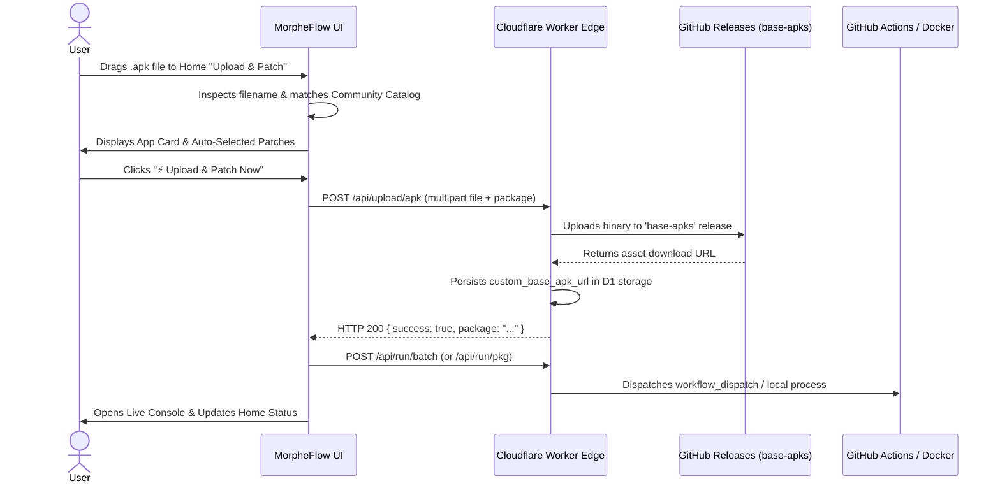

# Design Specification: Home Quick Upload & Patch Flow

**Date**: 2026-11-03  
**Status**: Approved / Ready for Implementation  
**Target Area**: Web Frontend (`web/frontend/index.html`, `web/frontend/js/app.js`), Worker API (`worker/router.ts`), and Backend Runner

---

## 1. Executive Summary & User Experience

This specification details the **All-in-One Home "Upload & Patch"** capability for MorpheFlow. Users can directly drag-and-drop or upload any `.apk` binary from their computer or phone right from the **Home / Overview** dashboard. 

The flow features **progressive disclosure**:
1. **Dropzone**: Drag-and-drop any `.apk`.
2. **Smart Detection**: Instantly parses filename and resolves app metadata against the 1,354-app Morphe Community Catalog, auto-matching recommended patches.
3. **1-Click Execution**: Streams binary upload with real-time progress bars, provisions the app, and immediately launches the patching build runner.

---

## 2. User Interface & Progressive Disclosure

### 2.1 Dashboard Action Bar
- Added to `.bento-header-actions` on the **Overview** deck (`#view-overview`):
  ```html
  <button class="btn btn-primary" id="btn-home-upload-patch" title="Upload an APK file to immediately configure and compile patches">
    <svg width="14" height="14" viewBox="0 0 24 24" fill="none" stroke="currentColor" stroke-width="2">
      <path d="M21 15v4a2 2 0 0 1-2 2H5a2 2 0 0 1-2-2v-4"></path>
      <polyline points="17 8 12 3 7 8"></polyline>
      <line x1="12" y1="3" x2="12" y2="15"></line>
    </svg>
    <span>Upload & Patch</span>
  </button>
  ```

### 2.2 Progressive 3-State Modal (`#modal-quick-upload-patch`)

```
┌─────────────────────────────────────────────────────────────┐
│ ⚡ Upload & Patch Application                             [×]│
├─────────────────────────────────────────────────────────────┤
│                                                             │
│   ┌ ─ ─ ─ ─ ─ ─ ─ ─ ─ ─ ─ ─ ─ ─ ─ ─ ─ ─ ─ ─ ─ ─ ─ ─ ─ ─ ┐   │
│     [APK Icon]                                              │
│     Drag & drop your .apk file here or click to browse      │
│     Supports standard APKs, split APKs, and custom builds   │
│   └ ─ ─ ─ ─ ─ ─ ─ ─ ─ ─ ─ ─ ─ ─ ─ ─ ─ ─ ─ ─ ─ ─ ─ ─ ─ ─ ┘   │
│                                                             │
│   ─── Detected Target Application ───────────────────────   │
│   [ App Icon ]  Reddit (com.reddit.frontpage)       v2024.44│
│                 58.4 MB • Clean Base APK                    │
│                                                             │
│   ─── Patch Configuration ───────────────────────────────   │
│   ✓ Morphe Patches: 38 Recommended Patches Auto-Matched     │
│   [ Customize Patches... ]                                  │
│                                                             │
│   [====================== 52% ========================]     │
│   Uploading: 30.4 MB / 58.4 MB (1.4 MB/s)                   │
│                                                             │
├─────────────────────────────────────────────────────────────┤
│ [Cancel]                              [ ⚡ Upload & Patch ] │
└─────────────────────────────────────────────────────────────┘
```

#### State 1: Idle (Dropzone Active)
- Clean, dashed glassmorphic dropzone with pulse effect on dragover.
- Hidden `<input type="file" accept=".apk">` triggered on click or drop.

#### State 2: App Detected & Patch Preview
- **Client-Side Metadata Parsing**:
  - Extracts potential package from filename (e.g., `ch.protonvpn.android_v5.20.57.0.apk` ➔ `ch.protonvpn.android`).
  - Looks up app name, icon, and compatible patch bundles from `morpheCatalogData`.
  - If filename is generic (e.g., `app-release.apk`), displays an autocomplete search input to select any of the 1,354 community apps or enter a custom package name.
- **Patch Bundle Recommendation**:
  - Auto-selects certified default patches for that package.
  - Displays count badge (e.g. `42 Patches Auto-Selected`).
  - Provides a toggle to expand/customize individual patch selections if desired.

#### State 3: Uploading & Immediate Build Handoff
- Uploads binary to `/api/upload/apk` with real-time `XMLHttpRequest.upload.onprogress` feedback (percent + MB + filename).
- Once upload responds HTTP 200:
  - Updates/adds the app config in storage with `custom_base_apk_url`.
  - Automatically calls `/api/run/batch` or `/api/run/pkg` to start the build runner immediately.
  - Closes upload modal, shows a success toast, and reveals the live execution console.

---

## 3. Data Flow & System Architecture



---

## 4. Error Handling & Edge Cases

1. **Non-APK File Uploaded**: Client-side MIME and `.apk` extension check blocks upload with immediate error toast.
2. **Generic / Unmatched Filename**: Autocomplete search dropdown falls back gracefully, letting user select from known catalog apps or define an unlisted package.
3. **Upload Interruption**: Network disconnect displays retry button and error banner without losing selected patch configuration.
4. **Already Existing App**: If the app is already in the Operations Queue, MorpheFlow seamlessly updates the base APK and version without duplicating the package.

---

## 5. Verification Plan

1. **Unit Testing**:
   - Validate filename parsing regex for package and version extraction.
   - Validate payload generation for `/api/upload/apk`.
   - Validate auto-patch selection mapping.
2. **Interactive UI Verification**:
   - Verify presence and clickability of `#btn-home-upload-patch` on the Home screen.
   - Verify modal opens, dropzone handles drag/drop and file selection, and progress bar animates.
   - Verify test suite passes (`npm test`).
