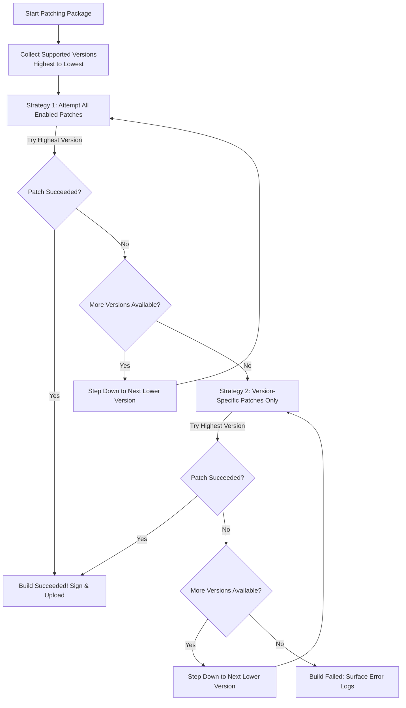

[🏠 Documentation Hub](README.md) › **User Guide & Configuration**

---

# MorpheFlow User Guide & Operations Manual

Welcome to the **MorpheFlow** user manual! This guide provides a comprehensive tour of the MorpheFlow console, Pure Patch Studio, Obtainium sync, keystore management, and build execution pipelines.

---

## 📑 Table of Contents

- [1. Operations Console & Live Telemetry](#1-operations-console--live-telemetry)
  - [1.1 Real-Time Operations Queue](#11-real-time-operations-queue)
  - [1.2 Direct Home "Upload & Patch" Flow](#12-direct-home-upload--patch-flow)
  - [1.3 SemVer 2.0 Version Analysis](#13-semver-20-version-analysis)
  - [1.4 Automated VirusTotal Security Audits](#14-automated-virustotal-security-audits)
- [2. App Provisioning & Pure Patch Studio](#2-app-provisioning--pure-patch-studio)
  - [2.1 Provision App Wizard](#21-provision-app-wizard)
  - [2.2 Pure Patch Studio (Drawer Interface)](#22-pure-patch-studio-drawer-interface)
  - [2.3 Patch Conflict Linting](#23-patch-conflict-linting)
  - [2.4 Patch Aliases (Cross-Repository Mapping)](#24-patch-aliases-cross-repository-mapping)
- [3. Keystore Management & Update Integrity](#3-keystore-management--update-integrity)
  - [3.1 Deterministic Signing Keystore](#31-deterministic-signing-keystore)
  - [3.2 Exporting & Importing Custom Keystores](#32-exporting--importing-custom-keystores)
- [4. Android Auto-Updates with Obtainium](#4-android-auto-updates-with-obtainium)
  - [4.1 1-Click Bulk Import](#41-1-click-bulk-import)
  - [4.2 Zero-Token Edge Feeds & Manifests](#42-zero-token-edge-feeds--manifests)
- [5. Execution Pipelines & Fallback Strategies](#5-execution-pipelines--fallback-strategies)
  - [5.1 Triggering Single & Batch Builds](#51-triggering-single--batch-builds)
  - [5.2 Patching Strategies (Strategy 1 vs. Strategy 2)](#52-patching-strategies-strategy-1-vs-strategy-2)
- [6. System Settings & Performance](#6-system-settings--performance)

---

## 1. Operations Console & Live Telemetry

### 1.1 Real-Time Operations Queue
The main MorpheFlow dashboard displays all configured target applications as interactive cards:
* **Status Badges**: Indicates whether a package is `Success`, `Running`, `Queued`, or `Awaiting Build`.
* **Execution Mutex**: Shows active execution locks, duration, and parallel workers.
* **Direct Actions**: Trigger immediate builds, configure patches, or download compiled APK binaries.

### 1.2 Direct Home "Upload & Patch" Flow (Local File or Direct URL)
For the fastest possible workflow without manually navigating menus:
1. Click the prominent **Upload & Patch** button in the Operations Queue header.
2. Choose your input mode:
   * **Upload File (.apk)**: Drag-and-drop or browse any local `.apk` binary.
   * **Direct Download URL**: Paste any direct HTTP/HTTPS link to an APK (GitHub release, CDN, S3, or direct mirror). MorpheFlow automatically extracts the filename, resolves query parameters, and auto-matches against the 1,354-app Community Catalog.
3. Review the detected app name, icon, and recommended patch count.
4. Click **Upload & Patch Now** (or **Link & Patch Now**): MorpheFlow provisions the package, links the base APK source, and immediately dispatches the build runner with live console streaming.

### 1.3 SemVer 2.0 Version Analysis
Each app card displays a high-visibility version matrix:
* **Recommended (Patches)**: The target version explicitly certified and tested by patch bundle authors.
* **Installed Base**: The version currently compiled, signed, and ready for download.
* **Target Version**: Dynamic status classifying whether an update is available (`Update Available`), installed (`Up to Date`), or building.

### 1.4 Automated VirusTotal Security Audits
Every compiled APK has its SHA-256 hash calculated automatically:
* Cards feature a green security shield with a verdict (e.g. `VT: 0/72 Clean`).
* Clicking the badge opens the official VirusTotal analysis report in a new tab.

---

## 2. App Provisioning & Pure Patch Studio

### 2.1 Provision App Wizard
1. Click **Provision App** (or **+**) in the top action bar.
2. Enter the package name (e.g., `com.reddit.frontpage`, `ch.protonvpn.android`).
3. MorpheFlow queries Google Play and fallback catalogs (Uptodown, APKCombo, APKPure) to auto-detect metadata, app icons, and compatible versions.

### 2.2 Pure Patch Studio (Drawer Interface)
Clicking **Options** on any app opens the **Pure Patch Studio** slide-out drawer:
* **4-Way Filtering**: Quickly filter patches by `All`, `App-Specific`, `Universal`, or `Selected`.
* **Collapsible Repositories**: Expand or collapse patch bundle sources (Morphe, ReVanced, Community).
* **Patch Aliases & Options**: Configure custom package names, user-agent overrides, or UI toggles.

### 2.3 Patch Conflict Linting
MorpheFlow detects mutually incompatible bytecode patches (such as conflicting video playback components or duplicate ad-blockers) and displays visual warnings before you launch a build.

### 2.4 Patch Aliases (Cross-Repository Mapping)
When combining multiple patch repositories, patches performing the identical role often have different names (e.g., `Unlock Premium` vs. `Enable Premium`):
1. **Define an Alias**: Create a logical alias name.
2. **Assign Patches per Repository**: Pick the matching patch for each repository.
3. **Dynamic Selection**: At build time, MorpheFlow inspects the target version and activates only the compatible patch across your configured repositories.

---

## 3. Keystore Management & Update Integrity

### 3.1 Deterministic Signing Keystore
Android requires applications to be signed by the identical cryptographic key to allow in-place updates without uninstalling. MorpheFlow includes a hardened, deterministic keystore configured out-of-the-box.

### 3.2 Exporting & Importing Custom Keystores
Under **Settings › Keystore Management**:
* **Export Keystore**: Download your active keystore binary for safekeeping or use in the Morphe Android app.
* **Import Keystore**: Upload your existing keystore file to ensure all cloud builds match your installed Android apps.
* When using Cloudflare Workers, custom keystores are automatically synchronized to your GitHub Actions Cloud Runner secrets.

---

## 4. Android Auto-Updates with Obtainium

### 4.1 1-Click Bulk Import
1. In the navigation bar, click **Obtainium Sync**.
2. Select the packages you want to track on your Android device.
3. Tap **Add All to Obtainium**.
4. The system invokes the `obtainium://apps/` deep link protocol, automatically adding all selected apps to Obtainium.

### 4.2 Zero-Token Edge Feeds & Manifests
* MorpheFlow generates public `/api/obtainium/manifest.json` feeds and dedicated per-app release tags (`app-<package_name>`).
* Obtainium uses regular-expression title filtering to monitor new releases and download updates silently in the background.

---

## 5. Execution Pipelines & Fallback Strategies

### 5.1 Triggering Single & Batch Builds
* **Single App**: Click the play icon on any individual app card.
* **Patch All Waiting**: Click **Patch All Waiting** in the action bar to queue all apps that have newer upstream versions available.
* Dispatches are handled in parallel with instant lock release if any individual build fails.

### 5.2 Patching Strategies (Strategy 1 vs. Strategy 2)
When patching an app, MorpheFlow executes an automated two-stage compatibility pipeline:

* **Strategy 1 (All Enabled Patches)**: Attempts to apply every enabled patch on the highest supported version.
* **Strategy 2 (Version-Specific Patches Only)**: If Strategy 1 fails, MorpheFlow resets and applies only patches certified for that specific version, ensuring a stable, working APK is always produced.

---

## 6. System Settings & Performance

* **Timezone & Schedule Time**: Configure cron trigger target hours (e.g., `03:00` for 3:00 AM UTC).
* **Storage Pruning**: Automatically prunes older historical logs, APK binaries, and rate-limit records to maintain database efficiency.
* **Theme Toggle**: Instantly switch between high-contrast dark mode and clean light mode.

---

[← Back to Documentation Hub](README.md)
